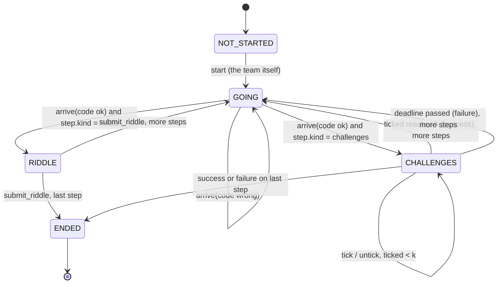

# State machine

Status: **draft for review**. Once agreed, this file is the contract for `graduapp/engine/`.

## 1. Principles

- The server owns the state. A phone only displays it and sends actions.
- The engine is pure: `transition(state, step, action, now) -> (new_state, events)`. No I/O, and `now` is injected.
- Expected business outcomes are **events, not exceptions**. A wrong code returns the unchanged state and a `CODE_REJECTED` event. Exceptions (`InvalidTransition`) are for actions that should never be possible from the UI: stale clicks, wrong phase.
- Every action carries the `step_index` the client was looking at. A mismatch means a stale screen and is rejected, so a double tap can never skip two steps.
- Expiry is **lazy**. Every action, and every page load, first runs `resolve_expiry(state, now)`.

## 2. State

| Field | Meaning |
|---|---|
| `step_index` | Current step in the team's itinerary (0-based). `== len(steps)` means finished. |
| `phase` | `NOT_STARTED`, `GOING`, `RIDDLE`, `CHALLENGES`, `ENDED` |
| `phase_deadline` | UTC timestamp, set only in `CHALLENGES`, otherwise null |

Stored separately (see [Datamodel.md](./Datamodel.md)):
- Ticked challenges, with the proof text (`challenge_completion`). The engine state holds the ids of the current step's ticks and of the general ticks.
- Unlocked general challenges are **derived**, never stored: the ones unlocked at start, plus the `unlocks` of every step the team has reached.

Game-wide setting, passed to the engine as `general_deadline`: the datetime until which general challenges can be ticked or unticked, set by the organiser at startup. `None` means no limit.

## 3. Phases and diagram

Note: general challenges (screen C) are **orthogonal**. They can be ticked or unticked in `GOING`, `RIDDLE`, `CHALLENGES` and `ENDED`, and never change `phase`.

## 4. Actions

| Action | Allowed in | Guard | Effect |
|---|---|---|---|
| `start` | `NOT_STARTED` | none, each team starts its own game | `step_index = 0`, `phase = GOING` |
| `arrive(code)` | `GOING` | code equals `step.code` | Add `step.unlocks` to the general list. `phase` becomes `RIDDLE`, or `CHALLENGES` with `deadline = now + step.duration`. |
| `submit_riddle(text)` | `RIDDLE` | text not empty | Store the answer (never judged), then advance. |
| `tick_step_challenge(id, text)` | `CHALLENGES` | `now < deadline`, id belongs to the step, not already ticked | Tick it. If ticked count `>= k`, success and advance. |
| `untick_step_challenge(id)` | `CHALLENGES` | `now < deadline`, ticked | Untick it. |
| `tick_general(id, text)` | any started phase | unlocked, not already ticked, `now < general_deadline` | Tick it. |
| `untick_general(id)` | any started phase | ticked, `now < general_deadline` | Untick it. |
| `resolve_expiry` | implicit, before every action and page load | `phase = CHALLENGES` and `now >= deadline` | Step failure, then advance. |

**Advance** means: `step_index += 1`. If it equals `len(steps)`, `phase = ENDED`. Otherwise `phase = GOING`, and the deadline is cleared.

## 5. Events (append-only log)

Each transition returns the events to persist, in the same transaction as the new state.

| Event | Payload | Raised by |
|---|---|---|
| `GAME_STARTED` | | `start` |
| `CODE_REJECTED` | step_index, code entered | `arrive` |
| `ARRIVED` | step_index | `arrive` |
| `CHALLENGES_UNLOCKED` | challenge ids | `arrive` |
| `CHALLENGE_PHASE_STARTED` | step_index, deadline | `arrive` |
| `RIDDLE_ANSWERED` | step_index, text | `submit_riddle` |
| `CHALLENGE_TICKED` | scope (`step`/`general`), id, text | tick actions |
| `CHALLENGE_UNTICKED` | scope, id | untick actions |
| `STEP_SUCCEEDED` | step_index, ticked count | k reached, or riddle answered |
| `STEP_FAILED` | step_index, ticked count | expiry |
| `GAME_ENDED` | | advance past the last step |

## 6. Edge cases and decisions

| Case | Rule | Why |
|---|---|---|
| Tick arrives after the deadline | Expiry is resolved first, then the tick is rejected as stale. | The server clock is the only clock. |
| Network lag at the last second | No grace period in v1. | Simple. Add a few seconds later if teams complain. |
| Double tap on "I am here" | Second request has an old `step_index` or wrong phase, so it is rejected. | Idempotent, nothing skipped. |
| Untick after step end | Rejected. Step challenges are frozen once the step closes. | The score was already decided. |
| Untick a general challenge | Allowed, with the confirm popup, until `general_deadline`. | Matches the spec. |
| General challenges after the team finished | Still tickable until `general_deadline`. | Finishing the route should not end the fun. |
| Action refused after expiry was resolved | `InvalidTransition` carries the advanced state and the `STEP_FAILED` event. The caller persists them, then reports the refusal. | Otherwise a late request would lose the failure. |
| Page reload or phone swap | The state is re-rendered from the DB. | The server owns the state. |
| `k` reached | Advance immediately, no further ticks. | Matches the spec. |
| Same itinerary shared by two teams | Fine. State is per team, and codes are per step. | You confirmed codes are per step. |
| Wrong code | Unlimited, but rate-limited by the web layer. Every attempt is logged. | Friendly game. |

## 7. Consequences for the other layers

- **DB (`schema.sql`)**: see [Datamodel.md](./Datamodel.md). Unlocked challenges are derived, not stored.
- **Content schema**: a step has `id`, `location`, `code`, `unlocks[]`, and exactly one of `riddle` or `challenges{ items[], k, duration_s }`.
- **Errors**: `WrongCode` was removed. `InvalidTransition` stays, and carries `state` and `events`.
- **Scoring**: computed from events (see below). Implemented in `engine/scoring.py`.

## 8. Scoring proposal (computed, not stored)

- Each challenge has `points` in the YAML (default 1).
- General challenges: points of each ticked and not unticked challenge.
- Step challenges: points only if the step ended in `STEP_SUCCEEDED`. A failed step still advances (and its unlocks are still given) but brings no points home.
- `step.points` is a bonus added for each `STEP_SUCCEEDED`.
- `step.points` is a bonus added for each `STEP_SUCCEEDED`, riddle steps included. Give riddle steps `points: 0`.
- Riddle answers are reviewed by the gamemaster, so they bring no computed points.
- Time is the tie-breaker (`GAME_ENDED.ts - GAME_STARTED.ts`). A failure on the last step is stamped with its deadline.

## 9. Open questions

Resolved: each team starts its own game; riddles have no timer; a failed step still advances and unlocks, but scores nothing; general challenges stay tickable until the organiser's `general_deadline`.

1. **Where is `general_deadline` stored?** A small `game_setting` table edited from the organiser screen, or an environment variable read at startup. I lean towards the table. It is decided with the repo layer.

---
# Game engine
---
The game engine is written and tested. The full suite passes (62 tests), and the engine's tests cover the whole game, including expiry and scoring.

**What's in `graduapp/engine/`**
- `states.py` holds `Phase`, `TeamState`, `StepDef` and `Course`. `unlocked_general()` derives the unlocked challenges from progress.
- `transitions.py` holds the actions and `transition(state, course, action, now, general_deadline)`. It also has `resolve_expiry`.
- `events.py` holds `Event` and the event types.
- `scoring.py` has `compute_score(events, course)`.
- `errors.py` keeps only `InvalidTransition`. I removed `WrongCode`, as planned.

**General challenges deadline**
- Ticking and unticking are allowed in any started phase, including after the team finishes, while `now < general_deadline`.
- `None` means no limit.
- It is a parameter of `transition`, so the engine stays pure. Where it is stored is still open. I lean towards a small `game_setting` table edited from the organiser screen, and I'll settle it with the repo layer.

**Design points to check**
- **Expiry on refused actions:** if a late request is refused, the step has still failed. So `InvalidTransition` carries the advanced state and the `STEP_FAILED` event, and the repo must save them before reporting the refusal. This is tested.
- **Failure timestamps:** failure events are stamped with the deadline, not the late request time. The tie-break duration therefore stays fair.
- **Challenge ticks:** reaching k ends the step at once. Unticking is only possible before that.
- **Code matching:** codes are matched ignoring case and surrounding spaces.
- **Purity:** an AST test fails the build if the engine imports Flask, sqlite3 or another layer.

`state_machine.md` now matches the implementation. The `general_deadline` question is now the only open item there.

Next is the repo layer, `db/repo.py`:
- Map content into a `Course`.
- Load a team's state and apply an action in one transaction, persisting events and ticks.
- Handle `InvalidTransition` by saving the expiry.
- Add the `game_setting` table.

Shall I start?
